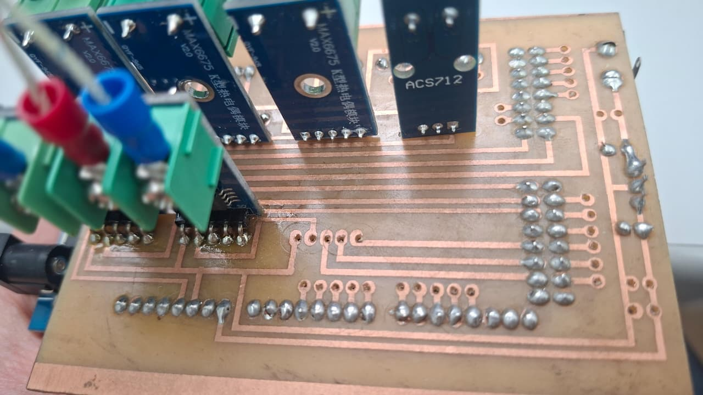
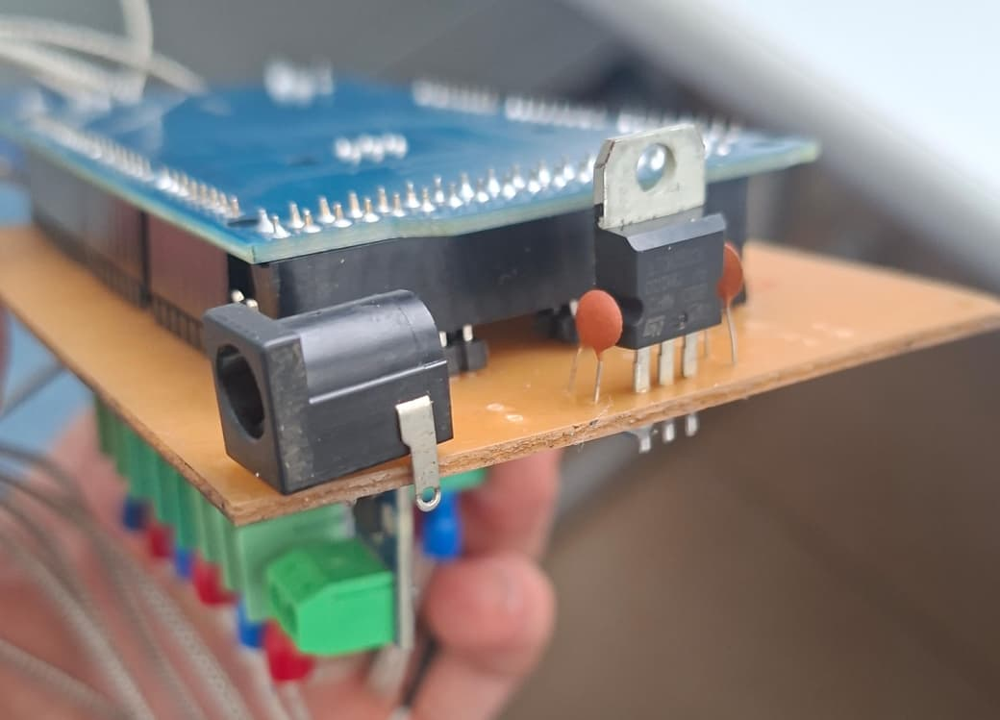
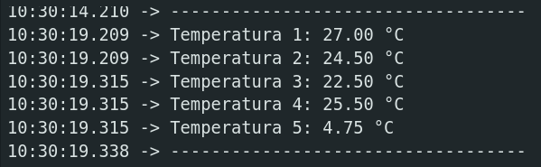
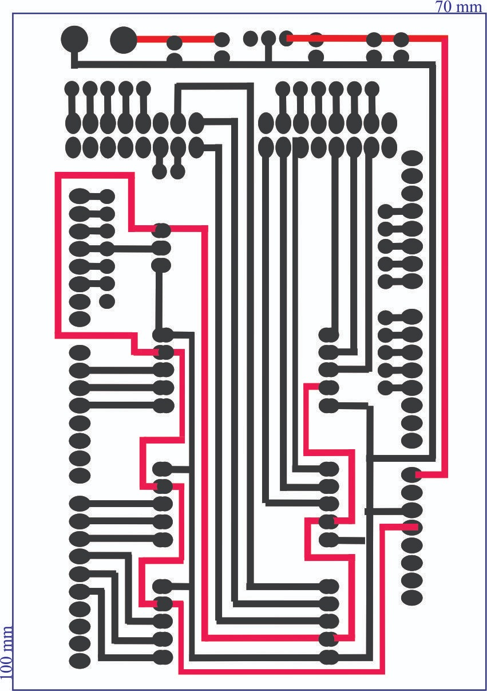
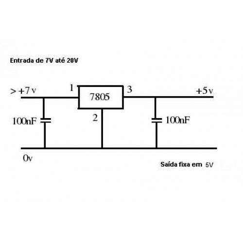

# PCB Temperature Sensor

A hardware and firmware project designed to monitor and read temperature metrics directly on printed circuit boards (PCBs).

  

  

## 🚀 Features
- Real-time temperature tracking.
- Design created for an Arduino Mega 2560.

## Future Expansion
- Overheating protection and safety alerts.
- Add the sixth sensor
- Share the same SPI bus pins

## Identified Problems:
- **Code Upload:** To upload the code to the arduino, it's necessary to remove the PCB Shield.
- **Pin TX:** In the diagram, the Sensor_01 SCK is incorrectly connected to the Arduino TX pin (though in the code, it has been assigned to pin 4).

## 🛠️ Hardware & Tools
- **EDA Software:** CorelDRAW
- **Arduino IDE V2:** v2.3.10 
- **Core Components:** MAX6675 v2.0, Arduino Mega 2560, ACS712, L7805CV
- **Firmware Language:** C / C++ (Arduino Framework)
- **Printing PCB:** Bambu Lab H2D with Laser 40w, Ferric Chloride

## Library
- **MAX6675 Adafruit:** v1.1.2
- **LiquidCrystal Adafruit:** v1.0.7

## Test
Sensor 5 is in the ice, which is why the temperature is low. The test was conducted using all the sensors, with both ice and a thermal heater.

  

## 📐 Schematic & Layout
Below is the circuit diagram for this module:

  

  

